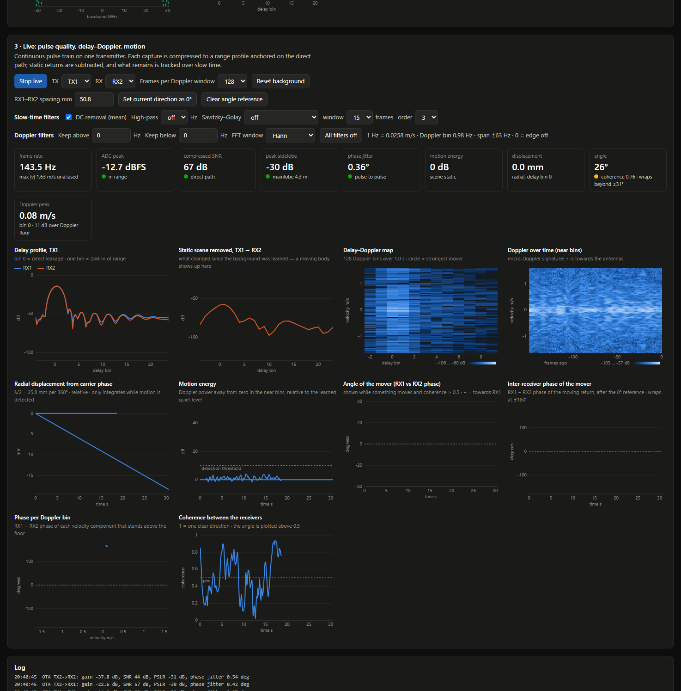

# pulse-radar

A browser-based bring-up tool and short-range pulse-Doppler radar for 2T2R
[AD9361](https://www.analog.com/en/products/ad9361.html) software-defined
radios running [PlutoSDR](https://wiki.analog.com/university/tools/pluto)
firmware. It walks through the chain step by step — are the samples reaching
the transmitter, are the pulses coming back, how clean are they — and then
runs live delay–Doppler, motion and two-receiver angle processing.



## What it does

1. **Digital loopback** — loops DAC-port samples to the ADC port inside the
   AD9361 and compares them with what was sent.
2. **Over-the-air test** — each transmitter fires alone; both receivers
   listen. The direct antenna-to-antenna leakage is the reference signal.
   Reports path gain, ADC level, clipping, SNR, range sidelobes, mainlobe
   width and pulse-to-pulse phase jitter for all four TX→RX paths.
3. **Live** — a cyclic linear-FM pulse train, pulse compression, static-scene
   removal, delay–Doppler map, Doppler-over-time, carrier-phase displacement,
   motion energy, and angle from the phase difference between the two
   receivers. Optional slow-time filters: DC removal, Butterworth high-pass,
   Savitzky–Golay detrend/smooth, Doppler band limits, FFT window choice.

4. **Two boards** — each board has its own tab with steps 1–3, so the boards
   can be tested one at a time. The **Both boards** tab runs them together:
   each board measures the angle of a moving hand between its own two
   receivers, and because the two receive pairs sit at different places along
   the array, the two angles together give a rough hand position (top view),
   a combined angle, and a swipe/wave detector.

The whole signal-processing chain is documented in the GUI's Help section.

## Setup

Python 3.11 and the libiio native library (for the live link).

```
pip install -r requirements.txt
```

## Run

```
python server.py            # then open http://localhost:8765
python server.py --port 9000
```

In the GUI choose a link and press **Connect**:

| Link | Needs | Speed |
|---|---|---|
| libiio | the board's data USB port (or Ethernet) | 100–300 captures/s |
| debug serial | only the board's UART console | about 1.5 captures/s |
| simulator | nothing | synthetic scene |

`auto` tries libiio first and falls back to the serial console. With two
boards plugged in, leave the URI empty and each board tab takes a USB board the
other is not using (or press **Scan USB** and pick one). Both boards answer on
192.168.2.1 and may report the same serial number, so the USB address
(`usb:bus.dev.intf`) is what tells them apart. `--boards N` sets how many board
tabs the server keeps (default 2).

Two-board defaults: board A at 5.765 GHz, board B at 5.835 GHz, so neither
board hears the other's chirp. The array geometry assumes two 2-inch receive
pairs on one line with a 50 mm gap between them (A: −75.8, −25.0 mm;
B: +25.0, +75.8 mm). Both can be changed in the **Both boards** tab. Appending
`?auto=auto` (or `sim`, `serial`, `iio`) to the URL runs every step unattended.

Command-line check without the GUI:

```
python bench.py [serial|iio|sim|auto] [sample_rate_hz] [rx_gain_db] [tx_gain_db]
```

## Files

| File | Purpose |
|---|---|
| `radar_dsp.py` | waveform, pulse compression, quality metrics, slow-time filters, Doppler |
| `radios.py` | libiio, debug-serial and simulator back-ends behind one interface |
| `server.py` | Tornado web server, radio worker thread, live processing |
| `index.html` | the GUI (plain canvas charts, no build step) |
| `bench.py` | command-line loopback and over-the-air check |

## Status

Measured on one Zynq-7020 + AD9361 board with PlutoSDR firmware v0.38, at
5.8 GHz with antennas about 5 cm apart:

- Digital loopback is bit-exact on both transmit chains at 30.72, 56 and
  61.44 Msps in 2R2T mode.
- All four TX→RX paths give a clean compressed pulse: about −30 dB range
  sidelobes with Hamming weighting and 0.2–0.6° pulse-to-pulse phase jitter.
- Live processing runs at 100–300 captures per second over USB. Motion of a
  person near the antennas shows up clearly in the Doppler plots and the
  motion-energy trace.
- Each slow-time filter was checked on the live radar and attenuates the
  bands it should.

Not done or not verified:

- **Angle** has not been checked against a known position. The sign
  convention is unverified, the two receive chains need a zero reference set
  by hand, and at this antenna spacing the angle is ambiguous beyond about
  ±31°.
- **Two-board position and angle** has only been checked in the simulator
  (about 1° median angle error, about 1–3 cm position error, with ideal
  signals). On the hardware, both boards run together at about 250 captures/s
  each, and an empty scene gives no false angle, but a hand at a known position
  has not been measured yet. With the two pairs only about 10 cm apart, range
  is poorly determined beyond about 30–40 cm, and each pair still wraps
  beyond ±31°.
- **Range** is coarse: one delay bin is 2.44 m at 61.44 Msps, so a person in
  the room is in the same bin as the leakage. The radar shows that something
  moves and how fast, not where it is.
- Slow-time sampling relies on host timestamps and is re-sampled to a uniform
  grid; there is no hardware timestamping.
- The displacement trace only integrates while motion is detected and is
  relative, not absolute.
- One receive channel showed a steady spur near ±46 Hz Doppler at high gain;
  the cause is unknown.

Transmitting needs to be legal where you are: check the rules for the band
and power you use.

## TODO

- **Check the two-board hand angle and position against a camera.** Film the
  hand with a camera at a known position relative to the antenna array, track
  the hand in each frame (for example with a hand-landmark model), convert it
  to array coordinates (x across the antennas, z out from them), and log it
  with timestamps next to the radar's combined angle, per-board angles and
  position estimate. This gives:
  - the real angle and position error, in place of simulator-only numbers;
  - the sign convention and RX1/RX2 order for each board;
  - a calibration taken from the camera's hand position instead of a hand
    held by eye at 30 cm;
  - how far out in range the position estimate is still usable.

## License

MIT, see [LICENSE](LICENSE). Third-party notes are in [NOTICE.md](NOTICE.md).
