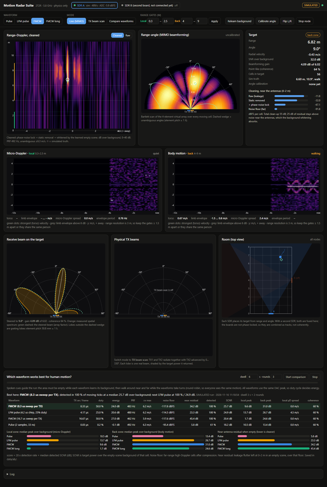

# pulse-radar · motion suite branch

A live human-motion radar for 2T2R
[AD9361](https://www.analog.com/en/products/ad9361.html) software-defined
radios running [PlutoSDR](https://wiki.analog.com/university/tools/pluto)
firmware, at 5.845 GHz. Physics only, no training: a cleaned range–Doppler
map, MIMO and physical TX beamforming you can see, micro-Doppler of a person
close to the radar, body motion further back, and a test of which waveform
(pulse, LFM pulse, FMCW, long FMCW) works best for a moving person.

It runs with one board now; a second board is a switch in `nodes.json`.



The code is in [`motion_suite/`](motion_suite/). Its
[README](motion_suite/README.md) has the full detail: every panel, the
antenna-layout settings, the calibration procedure and the physics limits.
The pulse-Doppler bring-up GUI this grew out of is still at the repo root
(see [below](#bring-up-gui-repo-root)).

## What it does

- **Range–Doppler, cleaned.** Leakage-anchored matched filtering, a
  phase-noise lock on the leakage, static-scene removal and whitening against
  a learned empty-scene background. A *Raw* toggle shows the map without the
  lock and whitening, and bars give the level in dBFS after each cleaning stage.
- **MIMO beamforming.** TX1 and TX2 take turns, so the 2 TX × 2 RX pairs form
  a 4-element virtual array. Range–angle map with the steered beam drawn on it,
  plus the measured receive beam against its array factor and the beamforming
  gain (6.02 dB ceiling).
- **Physical TX beams.** Both transmitters radiate together through 12 phase
  offsets; each beam is drawn and shaded by what it returned.
- **Micro-Doppler.** Scrolling spectrograms for a *local* range gate (default
  0.3–2.5 m) and a *back* gate (4–9 m), with torso speed, limb envelope,
  spread and stride period.
- **Waveform comparison.** Spoken cues guide a run in which every waveform
  learns the empty scene, then they take turns while you move. Results are
  scored and saved.
- **Two boards.** Each board tracks on its own and the room view fuses them as
  tracks. The boards are not phase-locked, so they are never combined coherently.
- **Simulator.** An articulated walking or waving person, run through the same
  pipeline, for use with no hardware.

## Setup

Python 3.11 and the libiio native library (for real boards; `--sim` needs
neither). From the repo root:

```
pip install -r requirements.txt
```

## Run

```
cd motion_suite
python server.py                          # boards from nodes.json -> http://localhost:8790/
python server.py --sim                    # no hardware: physics simulator
python server.py --uri A=ip:192.168.2.1   # reach the board over its network link
python selftest.py [--txbeam]             # headless check against simulated truth
```

Before trusting angles, enter where your antennas really are in `nodes.json`
→ `antennas` (the default assumes one uniform row 50.8 mm apart), then
calibrate: walk slowly toward and away from the radar along its centre line,
2–5 m from it.

## Status

- **Simulator:** walking was detected 99 % of the time and waving 100 %, with
  no false alarms. Median range error was 0.16 m. Calibration recovered hidden
  chain phases to within about 6°.
- **One board, empty room:** 400–520 captures/s, with 42 dB of leakage removed
  and no false targets.
- **Not done yet on hardware:** a person walking, angle calibration, the TX-beam
  scan and the waveform comparison.
- **Physics limits:**
  - Range resolution is 3 m (50 MHz bandwidth).
  - With the default layout, angles are unambiguous only within about ±30°.
  - A person standing still is mostly not detected, because detection works on
    Doppler.

## Bring-up GUI (repo root)

The original tool: a browser GUI that checks the chain step by step (digital
loopback, over-the-air test of all four TX→RX paths), then runs live
pulse-Doppler, motion and two-receiver angle processing.

```
pip install -r requirements.txt
python server.py            # then open http://localhost:8765
python bench.py [serial|iio|sim|auto]
```

Files: `radar_dsp.py`, `radios.py`, `server.py`, `index.html` and `bench.py`.
The `main` branch README describes it in full, including what was measured
and what is unverified.

Transmitting needs to be legal where you are: check the rules for the band
and power you use.

## License

MIT, see [LICENSE](LICENSE). Third-party notes are in [NOTICE.md](NOTICE.md).
